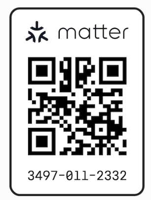

# ESP32 Testing (Wireless)
Used to test the Matter transport to see if a Matter endpoint receives a wireless payload correctly.

Currently supports ESP32-S3 DevKitC-1 v1.1. However, by changing the first of the if-elseif-statements "set" in the CMakeLists to your ESP32, it should use the sdkconfig for your ESP32.

```bash
if(NOT DEFINED ENV{ESP_MATTER_DEVICE_PATH})
    if("${IDF_TARGET}" STREQUAL "esp32" OR "${IDF_TARGET}" STREQUAL "")
        set(ENV{ESP_MATTER_DEVICE_PATH} $ENV{ESP_MATTER_PATH}/device_hal/device/esp32s3_devkit_c) # Change here!
    elseif("${IDF_TARGET}" STREQUAL "esp32c3")
```

Using ESP IDF 6.0.2 and ESP Matter 1.6.0 in a WSL environment. Please install the necessary dependencies and applications to build and flash the project.

It is not recommended to use the ESP32 extension for VSCode due to errors and the time it takes for the build process.

This is the QR code needed for commissioning:




This example is exactly the same as the light example in esp-matter, except that it uses the ESP32s3.

## Current Issues
1. Pressing the reset button or holding the boot button for commissioning seems buggy. It is best to use the serial monitor and repeatedly close/open it for commissioning or for testing BLE.

To close monitor (hold Ctrl and press the right bracket ]):
```bash
Ctrl + ]
```

To reopen monitor (replace `/dev/ttyUSB0` with your actual port):
```bash
cd "$ESP_MATTER_PATH/examples/light"
idf.py -p /dev/ttyUSB0 flash monitor
```

In addition, use a nRF Connect to check if the BLE is being broadcasted while opening/closing the serial monitor. The ESP32 should be repeatedly broadcasted.

## Current Progress (Wireless)
1. Creates the Matter endpoint
2. Has commissioning
3. Has different functionalities such as turning it on/off, changing colors, etc.
4. State of the light is reflected quickly for both HA and the ESP32.

### Tests Completed
1. ESP32 can be commissioned and its LED can be changed by Home Assistant.